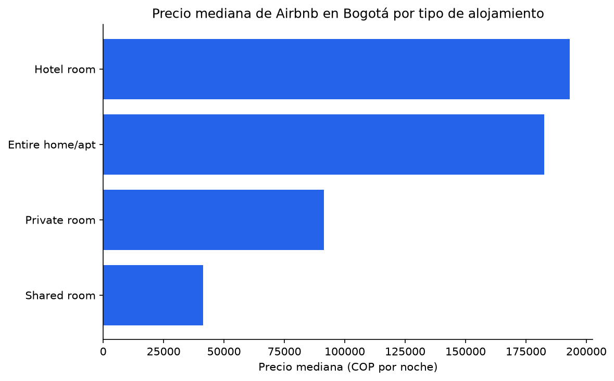
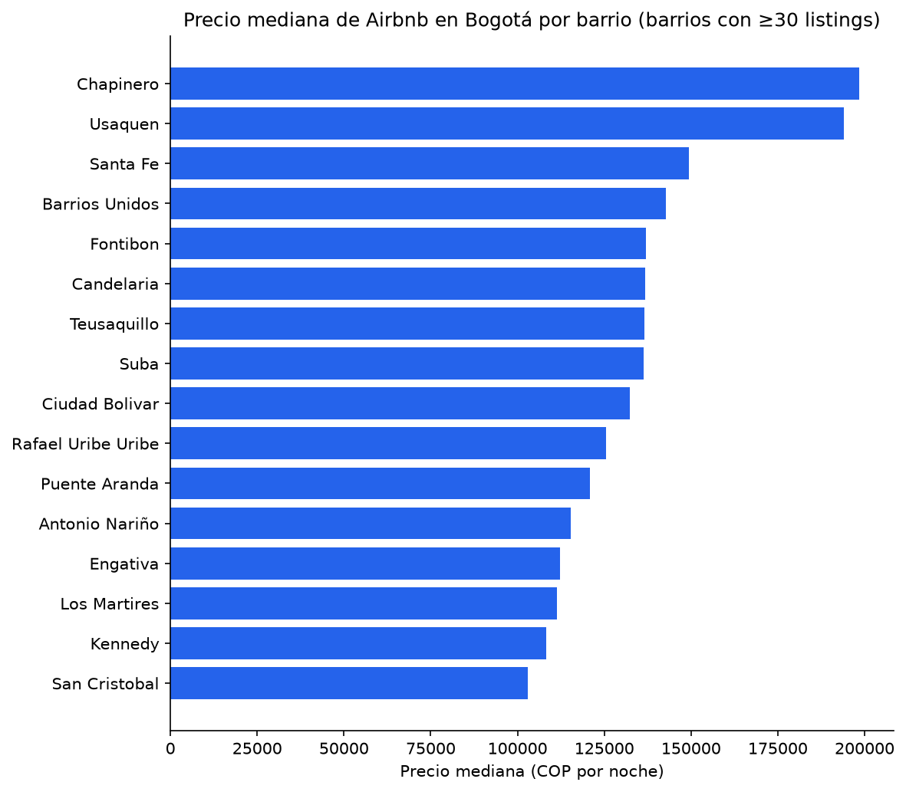
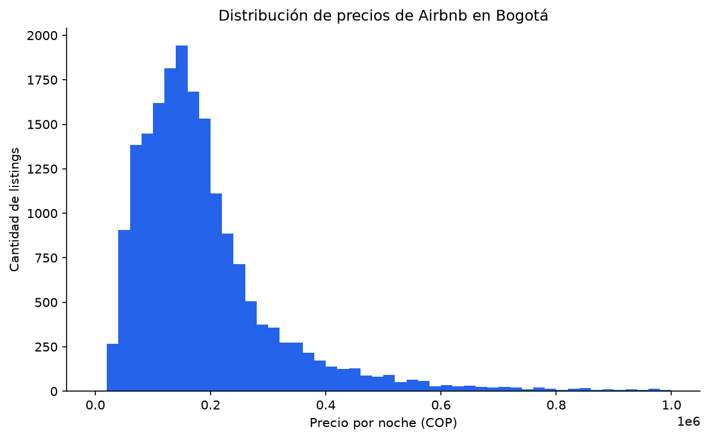
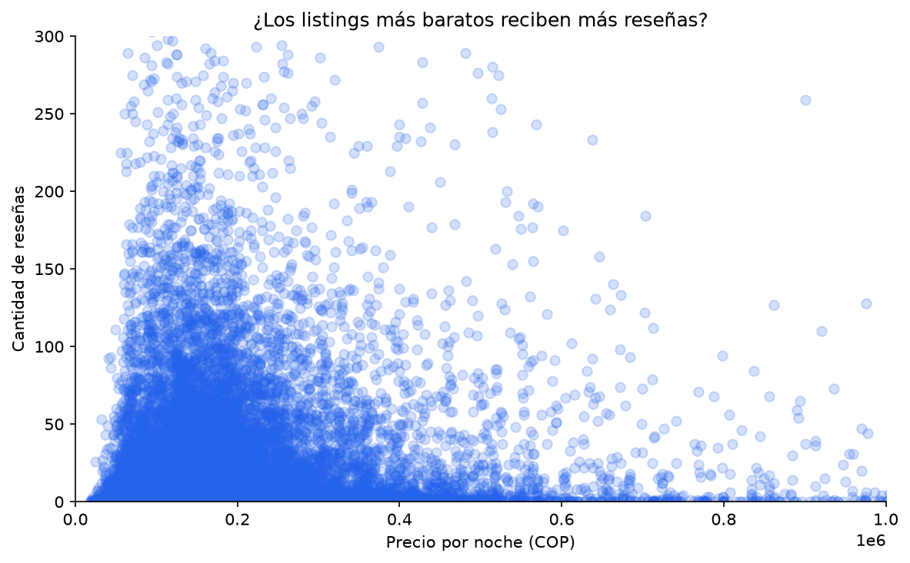
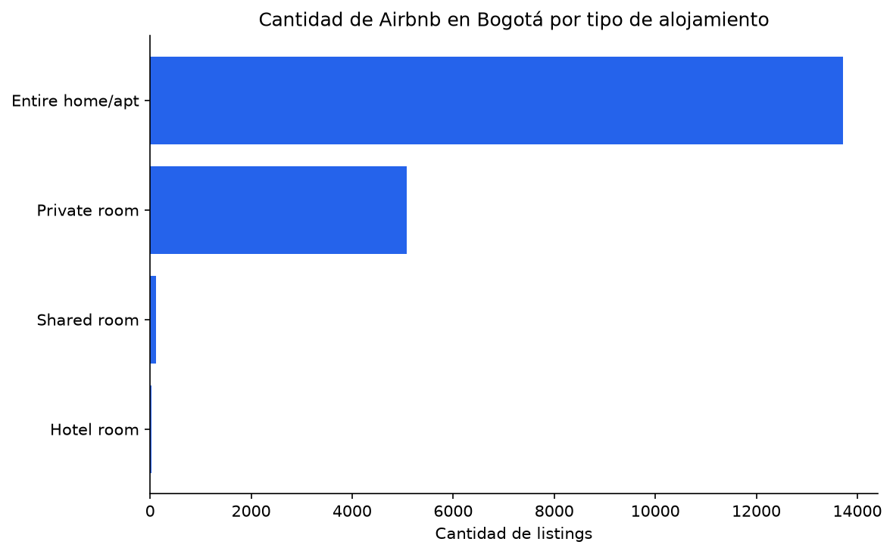

# Análisis de Airbnb en Bogotá: precio, ocupación y calidad de datos

Análisis exploratorio de los listings de Airbnb en Bogotá (datos públicos de [Inside Airbnb](https://insideairbnb.com/get-the-data/)), combinando **SQL real vía DuckDB** y **pandas** para responder una pregunta de negocio concreta y documentar hallazgos de calidad de datos en el camino.

## Resumen ejecutivo

**Pregunta de negocio:** ¿qué factores explican mejor el precio y la ocupación de los Airbnb en Bogotá, y qué le recomendaría a alguien que va a publicar un alojamiento nuevo para maximizar ingresos?

**Hallazgos principales:**

- El **tipo de alojamiento** es el factor de precio más claro: "Entire home/apt" tiene el precio promedio más alto, seguido de "Private room"; "Shared room" y "Hotel room" son marginales tanto en precio como en volumen.
- El **barrio** también explica diferencias de precio significativas, pero solo es confiable en barrios con suficiente volumen de listings (≥30) — en barrios con pocos listings, el "top 3 más caro" puede estar dominado por 1-2 casos atípicos, no por un patrón real del barrio.
- La mayoría de los precios se concentra entre 80,000 y 300,000 COP/noche, con una cola larga de precios altos poco frecuentes.
- **No hay evidencia de que el precio por sí solo determine la cantidad de reseñas** (proxy de ocupación/popularidad). La aparente concentración de reseñas en listings baratos es consistente con que, simplemente, hay muchos más listings baratos en el dataset — no con que ser barato "cause" más reseñas.
- Cerca de **20-22% de los listings no tienen ninguna reseña registrada**, un dato relevante para cualquier análisis de ocupación que use reseñas como proxy (hay que decidir explícitamente si excluirlos o tratarlos como 0, porque cambia el promedio).

**Recomendación para alguien publicando un alojamiento nuevo:** el tipo de alojamiento (ofrecer el espacio completo vs. una habitación) importa más para el precio que el barrio específico, salvo en zonas de alta demanda consolidada. Reseñas acumuladas no parecen estar impulsadas por precio bajo, así que compito en precio no garantiza más reseñas/visibilidad.

## Fuente de datos

[Inside Airbnb](https://insideairbnb.com/get-the-data/) — Bogotá D.C., datos públicos y reales, snapshot del 21 de junio de 2026.

- `listings.csv`: 19,187 filas × 90 columnas (detalle de cada alojamiento).
- `reviews.csv`: 527,731 filas × 2 columnas (`listing_id`, `date` — una fila por reseña individual).

## Metodología

1. **Limpieza de precios:** se excluyeron listings con precio > 5,000,000 COP/noche (outliers extremos, probablemente errores de carga o listings de lujo atípicos no representativos), usando análisis de rango intercuartílico (IQR) para justificar el corte → `df_precio_limpio`.
2. **Exploración por `room_type` y `neighbourhood_cleansed`:** agregaciones con `GROUP BY` en pandas y en SQL (DuckDB), verificando que ambos métodos dieran el mismo resultado.
3. **Investigación de calidad de datos (caso "72Hub By Jalo"):** un listing con 6,162 reseñas registradas resultó, al cruzar `listings.csv` con `reviews.csv` y calcular reseñas/día, físicamente implausible como un solo alojamiento. Conclusión: id probablemente reciclado o compartido por una operadora de co-living — limitación conocida y documentada del dataset, no un error del análisis.
4. **JOIN de listings con reviews:** `LEFT JOIN` para contar reseñas por listing sin perder los que no tienen ninguna; `COALESCE(num_reviews, 0)` para tratar los `NULL` como 0 en los promedios (evita sesgo de excluir silenciosamente esos listings).
5. **Ranking por barrio:** `ROW_NUMBER() OVER (PARTITION BY neighbourhood_cleansed ORDER BY price_clean DESC)` para encontrar el top 3 más caro de cada barrio sin colapsar filas (a diferencia de `GROUP BY`), filtrado luego a barrios "confiables" (`HAVING COUNT(*) >= 30`) vía subconsulta.
6. **Visualización:** 5 gráficos con matplotlib (ver abajo).

## Hallazgos y gráficos

### 1. Precio promedio por tipo de alojamiento


"Entire home/apt" tiene el precio promedio más alto, seguido de "Private room"; "Shared room" y "Hotel room" quedan muy por debajo.

### 2. Precio promedio por barrio (solo barrios confiables, ≥30 listings)


Hay diferencias reales entre barrios, pero el filtro de volumen mínimo es clave: sin él, barrios con 1-2 listings caros pueden aparentar ser "los más caros" sin serlo de verdad.

### 3. Distribución de precios


La mayoría de los listings se concentra entre 80,000 y 300,000 COP/noche, con una cola larga hacia precios más altos.

### 4. Precio vs. cantidad de reseñas


No se observa una relación clara entre precio y cantidad de reseñas. La mayor densidad de puntos en precios bajos es consistente con que ahí ya se concentran más listings (ver gráfico 3), no necesariamente con que los listings baratos sean más "populares". Se excluyó de la vista el outlier conocido (72Hub, 6,162 reseñas) ajustando el eje Y.

### 5. Composición del mercado por tipo de alojamiento


El mercado está dominado por "Entire home/apt", seguido de "Private room"; "Shared room" y "Hotel room" son una fracción marginal de la oferta total.

## Limitaciones del dataset

- El caso "72Hub By Jalo" (6,162 reseñas) no se eliminó del dataset — se documentó y se excluyó solo de la vista en el gráfico 4 — porque no hay evidencia de que sea un error de carga, sino más bien una particularidad de cómo algunas operadoras gestionan sus listings.
- ~20-22% de los listings no tienen ninguna reseña, lo que limita el uso de "cantidad de reseñas" como proxy de ocupación real (puede reflejar listings nuevos, no necesariamente poco demandados).
- El dataset es un snapshot único (21 jun 2026), no una serie de tiempo — no permite conclusiones sobre tendencias o estacionalidad.

## Stack técnico

- **DuckDB** — SQL real ejecutado directo sobre los CSV (sin necesidad de una base de datos tradicional).
- **pandas** — limpieza y manipulación de datos.
- **matplotlib** — visualización.
- **Jupyter Notebook** — desarrollo y documentación del análisis.

## Cómo reproducirlo

```bash
# clonar el repo
git clone <url-del-repo>
cd airbnb-bogota

# crear entorno e instalar dependencias
python -m venv venv
source venv/bin/activate
pip install pandas duckdb jupyter matplotlib

# descargar los datos (Inside Airbnb, Bogotá)
wget -O listings.csv.gz "https://data.insideairbnb.com/colombia/dc/bogotá/2026-06-21/data/listings.csv.gz"
wget -O reviews.csv "https://data.insideairbnb.com/colombia/dc/bogotá/2026-06-21/visualisations/reviews.csv"

# abrir el notebook
jupyter notebook analisis-airbnb-bogota.ipynb
```

## Autora

Daniela Ardila — [LinkedIn](#) · [GitHub](#)
